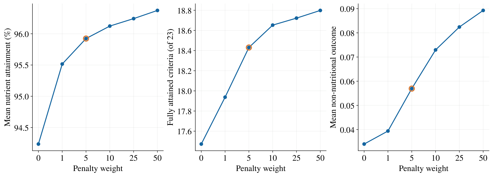

# S1. Complementary algorithm indicators

[Supplementary results](README.md)

Table [S1](#table-s1) reports proximity to the empirical reference fronts. Lower IGD+ is preferred within a profile and objective set. The reference is pooled from the compared methods, so the values describe coverage of their shared sampled alternatives rather than distance to the unknown true front.

**Table S1.** Median IGD+ over 20 runs per profile, objective set and algorithm. GLOBAL gives each profile equal weight within a replicate. The pooled empirical reference and normalization are specific to each profile and objective set; no cross-dimensional ranking is implied.

| Profile | Algorithm | NC | NW | ND | NCW | NCD | NWD |
| --- | --- | --- | --- | --- | --- | --- | --- |
| F30 | NSGA-II | 0.01708 | 0.01418 | 0.00857 | 0.02964 | 0.01365 | 0.01954 |
| F30 | SPEA2 | 0.01823 | 0.02558 | 0.009093 | 0.02336 | 0.01352 | 0.01753 |
| F30 | NSGA-III | 0.01985 | 0.02643 | 0.008529 | 0.03329 | 0.01217 | 0.02785 |
| F30 | SMS-EMOA | 0.01826 | 0.02107 | 0.009023 | 0.0315 | 0.01312 | 0.01545 |
| F60 | NSGA-II | 0.01159 | 0.01466 | 0.004243 | 0.02082 | 0.007156 | 0.02263 |
| F60 | SPEA2 | 0.01063 | 0.01855 | 0.003995 | 0.01996 | 0.007308 | 0.01369 |
| F60 | NSGA-III | 0.009577 | 0.01677 | 0.002657 | 0.02077 | 0.007303 | 0.01535 |
| F60 | SMS-EMOA | 0.01225 | 0.02011 | 0.005142 | 0.0197 | 0.009494 | 0.01339 |
| M30 | NSGA-II | 0.009881 | 0.01024 | 0.002574 | 0.0101 | 0.00462 | 0.003657 |
| M30 | SPEA2 | 0.01143 | 0.00804 | 0.002326 | 0.01004 | 0.004524 | 0.004843 |
| M30 | NSGA-III | 0.01076 | 0.009343 | 0.002914 | 0.009329 | 0.004971 | 0.005526 |
| M30 | SMS-EMOA | 0.01059 | 0.008051 | 0.00242 | 0.008511 | 0.004037 | 0.005297 |
| M60 | NSGA-II | 0.01128 | 0.0253 | 0.00842 | 0.01524 | 0.009354 | 0.01498 |
| M60 | SPEA2 | 0.007292 | 0.01948 | 0.007251 | 0.02021 | 0.009777 | 0.01341 |
| M60 | NSGA-III | 0.006851 | 0.01566 | 0.008747 | 0.01458 | 0.009039 | 0.01316 |
| M60 | SMS-EMOA | 0.01533 | 0.02615 | 0.007113 | 0.01269 | 0.008862 | 0.01438 |
| GLOBAL | NSGA-II | 0.01439 | 0.01739 | 0.006482 | 0.02148 | 0.01175 | 0.01399 |
| GLOBAL | SPEA2 | 0.01366 | 0.01922 | 0.005978 | 0.01994 | 0.01252 | 0.01403 |
| GLOBAL | NSGA-III | 0.01281 | 0.02036 | 0.006733 | 0.02034 | 0.008761 | 0.01518 |
| GLOBAL | SMS-EMOA | 0.0171 | 0.02012 | 0.007237 | 0.01833 | 0.00867 | 0.01366 |

[Download CSV](tables/table-s1.csv)

Table [S2](#table-s2) reports optimizer time under the same evaluation limit. It complements the quality indicators by showing the computation required by each implementation in the stated environment.

**Table S2.** Median optimizer wall-clock seconds over 20 runs. Every algorithm received 16500 objective-function evaluations. GLOBAL uses equal-profile means within each matched replicate before taking the median.

| Profile | Algorithm | NC | NW | ND | NCW | NCD | NWD |
| --- | --- | --- | --- | --- | --- | --- | --- |
| F30 | NSGA-II | 5.362 | 5.442 | 5.523 | 5.358 | 5.462 | 5.542 |
| F30 | SPEA2 | 5.506 | 5.473 | 5.534 | 5.489 | 5.531 | 5.668 |
| F30 | NSGA-III | 5.515 | 5.587 | 5.627 | 5.612 | 5.676 | 5.797 |
| F30 | SMS-EMOA | 41.05 | 41.14 | 41.38 | 41.04 | 41.3 | 42.77 |
| F60 | NSGA-II | 5.69 | 5.621 | 5.766 | 5.685 | 5.673 | 5.783 |
| F60 | SPEA2 | 5.777 | 5.682 | 5.752 | 5.706 | 5.787 | 5.831 |
| F60 | NSGA-III | 5.791 | 5.717 | 5.824 | 5.782 | 5.855 | 5.878 |
| F60 | SMS-EMOA | 43.39 | 43.06 | 43.77 | 43.24 | 43.32 | 44.39 |
| M30 | NSGA-II | 5.717 | 5.669 | 5.605 | 5.362 | 5.356 | 5.309 |
| M30 | SPEA2 | 5.806 | 5.757 | 5.695 | 5.472 | 5.544 | 5.374 |
| M30 | NSGA-III | 5.852 | 5.838 | 5.775 | 5.664 | 5.696 | 5.563 |
| M30 | SMS-EMOA | 43.83 | 43.6 | 43.16 | 40.85 | 41.35 | 40.54 |
| M60 | NSGA-II | 5.426 | 5.312 | 5.446 | 5.332 | 5.342 | 5.353 |
| M60 | SPEA2 | 5.402 | 5.414 | 5.47 | 5.366 | 5.346 | 5.397 |
| M60 | NSGA-III | 5.527 | 5.478 | 5.515 | 5.511 | 5.473 | 5.603 |
| M60 | SMS-EMOA | 41.75 | 41.3 | 42.2 | 41.04 | 41.02 | 41.06 |
| GLOBAL | NSGA-II | 5.56 | 5.493 | 5.581 | 5.448 | 5.446 | 5.501 |
| GLOBAL | SPEA2 | 5.624 | 5.569 | 5.637 | 5.487 | 5.535 | 5.565 |
| GLOBAL | NSGA-III | 5.667 | 5.628 | 5.717 | 5.627 | 5.655 | 5.692 |
| GLOBAL | SMS-EMOA | 42.6 | 42.32 | 42.61 | 41.53 | 41.78 | 42.15 |

[Download CSV](tables/table-s2.csv)

## S1.1 Reduced-weight response curves

**Figure S1.** Reduced-study means across the six tested weights. The marked weight is selected by the registered nutritional-plateau and non-nutritional-outcome rule. Lines connect tested settings, with equal spacing used to display the ordered weights; they do not estimate untested weights.

[Download PDF](figures/penalty-calibration.pdf)

Figure [S1](#figure-s1) shows why the selection rule retained a weight near the beginning of the attainment plateau: the non-nutritional outcome continued to increase as subsequent gains in attainment became smaller.
