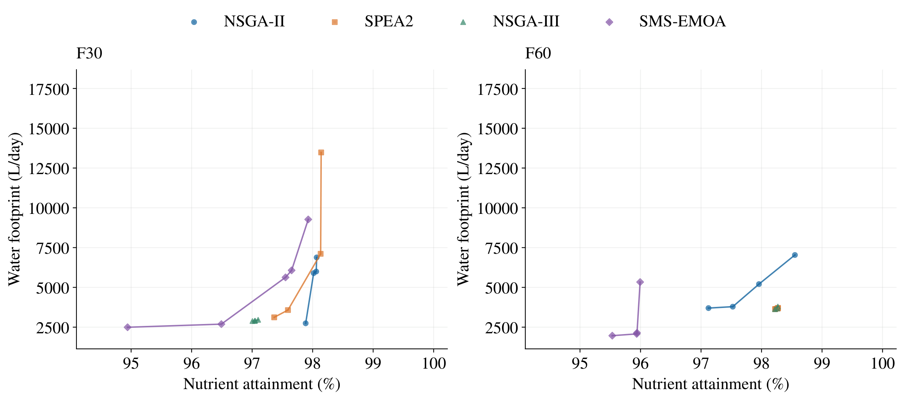
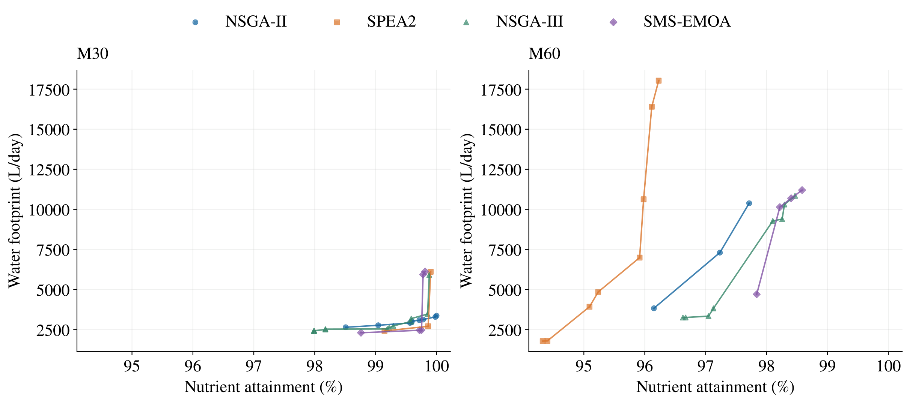
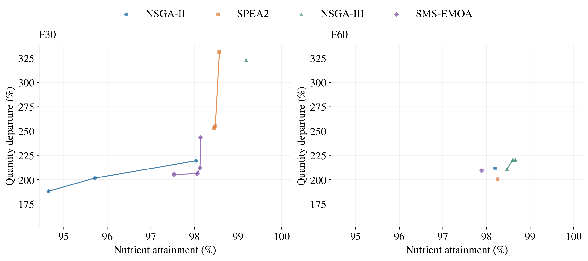
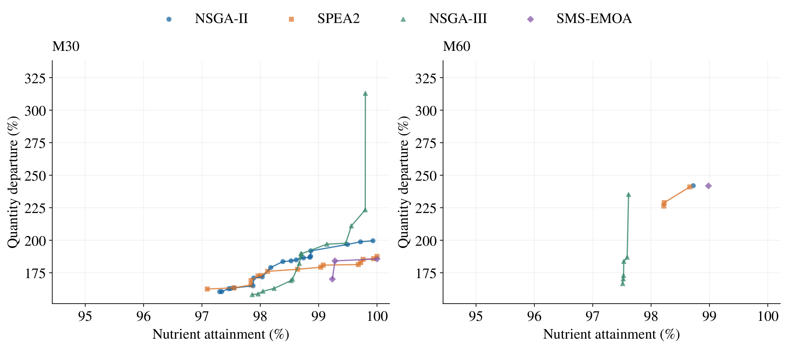
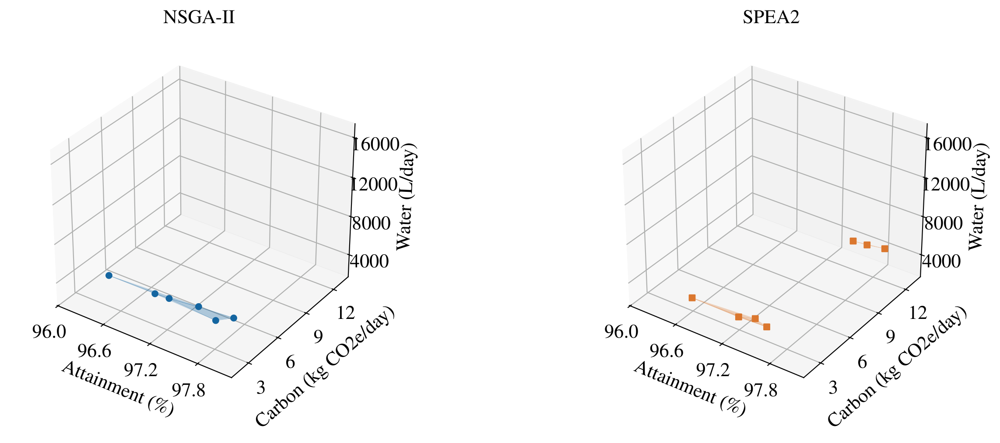
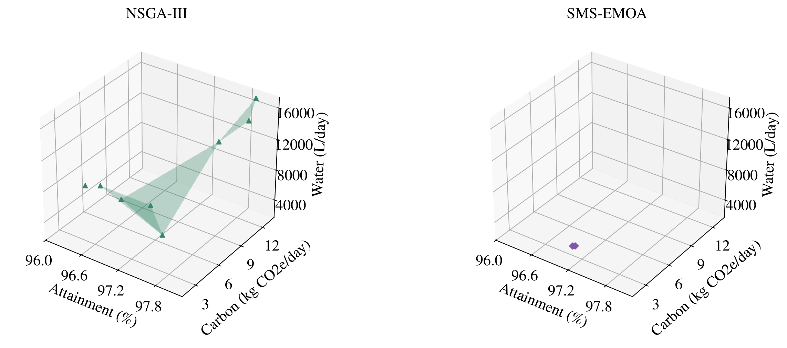
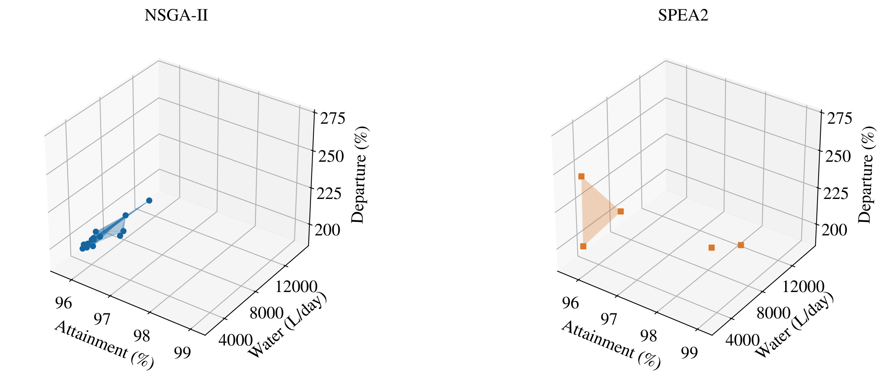
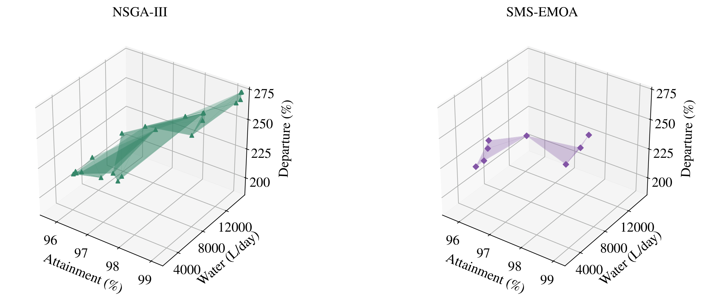

# S2. Additional Pareto-front views

[Supplementary results](README.md)

## S2.1 Water and quantity-departure pairs

Figures [S2](#figure-s2) and [S3](#figure-s3) show the nutrient–water trade-offs for women and men. Figures [S4](#figure-s4) and [S5](#figure-s5) replace the environmental coordinate with departure from observed food quantities. The representative-run selection is the same as in the main figures, and shared limits allow the profiles to be read together.

**Figure S2.** Representative NW fronts for women (F30 and F60), with water in L/day and shared axis limits. Attainment is maximized and water minimized.

[Download PDF](figures/pareto-2d-N-W-row-1.pdf)

**Figure S3.** Representative NW fronts for men (M30 and M60), with water in L/day and shared axis limits. Attainment is maximized and water minimized.

[Download PDF](figures/pareto-2d-N-W-row-2.pdf)

**Figure S4.** Representative ND fronts for women (F30 and F60). Departure is a percentage relative to observed food/position mass, excluding tap water.

[Download PDF](figures/pareto-2d-N-D-row-1.pdf)

**Figure S5.** Representative ND fronts for men (M30 and M60). Departure is a percentage relative to observed food/position mass, excluding tap water.

[Download PDF](figures/pareto-2d-N-D-row-2.pdf)

## S2.2 Three-objective environmental and departure views

Figures [S6](#figure-s6) and [S7](#figure-s7) show the NCW alternatives, distinguishing menus with similar carbon but different water footprints. Figures [S8](#figure-s8) and [S9](#figure-s9) add departure to the nutrient–water comparison. The surfaces join evaluated points under the interpolation rule in Section 2.4.5; they do not add feasible menus. The F30 NCW representatives cover different water ranges. NSGA-II spans 5442–6227 L/day across six points, SMS-EMOA 2241–2437 L/day across two points, and NSGA-III 5424–16787 L/day across eight points. Thus a two-coordinate view would omit part of the environmental difference among these menus.

**Figure S6.** F30 NCW fronts for NSGA-II and SPEA2, using shared attainment, carbon and water limits. Surface faces are interpolation between evaluated menus.

[Download PDF](figures/pareto-3d-f30-N-C-W-row-1.pdf)

**Figure S7.** F30 NCW fronts for NSGA-III and SMS-EMOA, using shared attainment, carbon and water limits. Surface faces are interpolation between evaluated menus.

[Download PDF](figures/pareto-3d-f30-N-C-W-row-2.pdf)

In F30 NWD, NSGA-II retains 16 points spanning 2106–10950 L/day and 188.3–225.3% departure, while NSGA-III retains 21 points spanning 4955–14739 L/day and 196.6–273.3%. The number and spread of points describe different choices; a larger plotted surface does not itself mean lower water or departure.

**Figure S8.** F30 NWD fronts for NSGA-II and SPEA2, using shared attainment, water and departure limits. Surface faces are interpolation between evaluated menus.

[Download PDF](figures/pareto-3d-f30-N-W-D-row-1.pdf)

**Figure S9.** F30 NWD fronts for NSGA-III and SMS-EMOA, using shared attainment, water and departure limits. Surface faces are interpolation between evaluated menus.

[Download PDF](figures/pareto-3d-f30-N-W-D-row-2.pdf)
